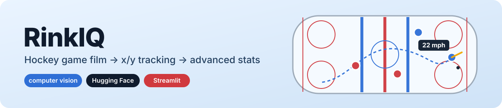
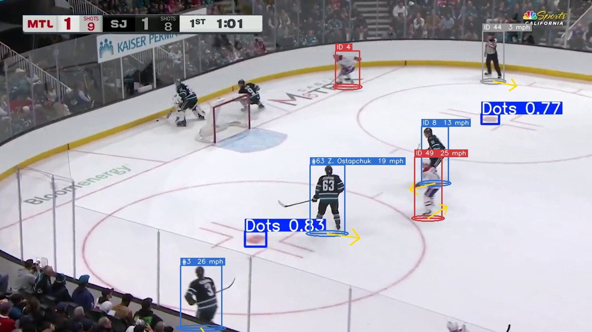
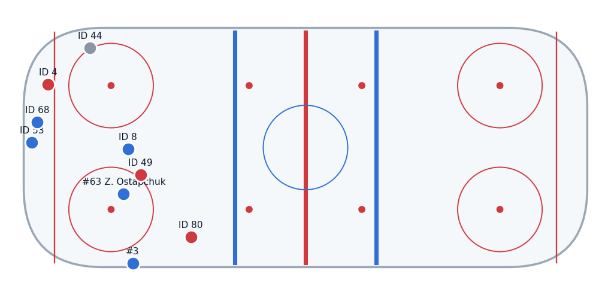
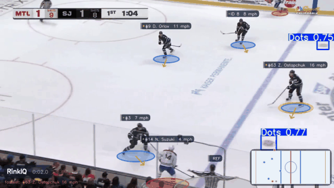
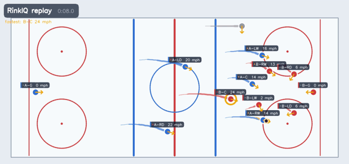
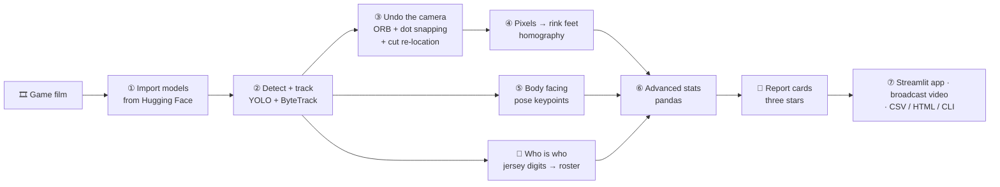
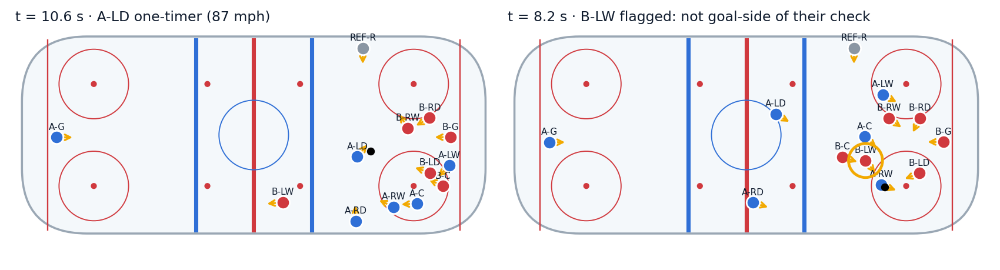
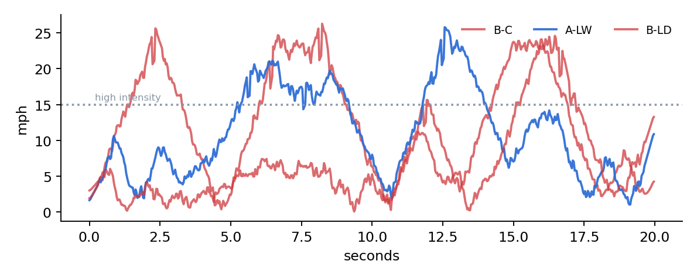

<p align="center"></p>

<p align="center">
  
  
  
  
</p>

**RinkIQ watches hockey game film and turns it into numbers.** Drop a video into the **🚀 Analyze a video**
tab and it finds the rink by itself (no clicking), tracks every player, and hands back a broadcast-style
video, three stars and a report. It works out how fast every skater is
going, where they are on the ice, which way their body is facing, how hard each shot is, who is out of
position, *who they are* (jersey number → roster name), and **who played well and why**. Then it draws all
of it back onto the video like a TV broadcast. It handles full-length games: camera cuts, resumable runs.
It's built from pretrained Hugging Face vision models, a classic homography, and an analytics layer written
in plain pandas and checked against ground truth.

<p align="center">
  
  
  <br><sub>Real NHL broadcast frame → every skater detected, tracked and labelled with live speed and body-facing arrow → the same moment mapped onto a top-down rink.</sub>
</p>

### 🎬 The analysis, drawn back onto the film

<p align="center">
  
  <br><sub>Real NHL film, rendered by <code>rinkiq/render.py</code>: team rings, motion trails that stay glued to the ice while the camera pans, name + live-speed tags (names read from jerseys and matched to the NHL roster), body-facing arrows, a gold ring on the fastest skater, and a mini-map.</sub>
</p>
<p align="center">
  
  <br><sub>The demo game as a top-down replay: zone entry → one-timer (SHOT 87 MPH) → rebound.</sub>
</p>

---

<a id="learn"></a>
## 🎓 New to computer vision? Start here

This repo doubles as a **beginner's course**. It explains every step of how a program turns TV footage into *"#3 hit 21.4 mph and was out of position"*,
using this project's real code, from "what is a pixel?" up.

| | |
|---|---|
| 📖 **Read** | **[`docs/LEARN.md`](docs/LEARN.md)**: the ideas in plain English, each with 🧠 the concept, 🔍 where it lives in the code, 💻 something to try, ⚠️ a common gotcha, and ✅ a check-yourself question |
| 🧪 **Run** | **[`notebooks/learn_cv_step_by_step.ipynb`](notebooks/learn_cv_step_by_step.ipynb)**: shows the image at *every* stage. Already run, so you can read it right on GitHub |
| 🎛️ **Play** | the **🎓 Learn CV** tab in the app: the same steps with sliders |

**You'll learn:** pixels → detection (YOLO) → tracking (IoU) → camera motion (ORB + RANSAC) → homography → smoothing & speed → pose → validation against ground truth. A glossary and "where to go next" are at the end.

---

## 🧭 The walkthrough (read this first)



| Step | What happens | Where |
|---|---|---|
| **① Import models** | Download small YOLO detectors trained on NHL broadcasts from [`AlexRHaigh/Hockey-Vision`](https://huggingface.co/AlexRHaigh/Hockey-Vision): players + team, puck, rink lines, faceoff dots. Add `yolov8n-pose` for body keypoints. | [`rinkiq/models.py`](rinkiq/models.py) |
| **② Detect + track** | Every frame: find every skater, goalie and ref. ByteTrack keeps one ID per person, and the team label is a majority vote over the track. | [`rinkiq/pipeline.py`](rinkiq/pipeline.py) |
| **③ Undo the camera** | Broadcast cameras pan. ORB feature matching (players and burned-in score graphics masked out) follows the camera. Detected faceoff dots snap the estimate back onto the real rink, which fixes drift. After a **camera cut**, the new view is matched against a bank of already-calibrated keyframes, so it's placed on the rink automatically. | [`rinkiq/camera.py`](rinkiq/camera.py), [`rinkiq/pipeline.py`](rinkiq/pipeline.py) |
| **④ Pixels → feet** | **Automatic:** the dots and rink models find faceoff dots, circles, goals and painted lines. Every consistent way of matching them to an NHL rink is fitted (points *and* lines in one homography) and judged on markings it wasn't fitted to, on whether the projected rink lands on white ice, and on rules no real camera breaks. Or click ≥ 4 landmarks by hand. | [`rinkiq/autocal.py`](rinkiq/autocal.py), [`rinkiq/rink.py`](rinkiq/rink.py) |
| **⑤ Body facing** | Shoulder order (front/back), shoulder width (angle to camera) and nose offset (left/right) give a facing vector, which feeds the *skating backwards* stat. | [`rinkiq/pose.py`](rinkiq/pose.py) |
| **👤 Who is who** | A digit detector reads jersey numbers on player crops, and each track votes over time. Team + number → name, from the public NHL API or a pasted roster. Broken track pieces with the same number are merged back into one player. | [`rinkiq/identity.py`](rinkiq/identity.py) |
| **⑥ Stats** | Smoothing, kinematics, possession, passes, shots, goal-side, structure, team shape and a composite *Skate Score*. | [`rinkiq/metrics.py`](rinkiq/metrics.py) |
| **🏅 Report cards** | Every stat becomes a percentile among the skaters in the video. The best and worst become plain sentences, a letter grade and three stars. | [`rinkiq/report.py`](rinkiq/report.py) |
| **⑦ Present** | Streamlit app: live preview while processing, broadcast-style video, film scrubber, report cards, leaderboard, heatmaps, rink replay, a clickable "out of position" review list, and an HTML report. | [`app.py`](app.py), [`rinkiq/render.py`](rinkiq/render.py) |

### What it measures

| Skating | Puck & events | Positioning |
|---|---|---|
| Top speed (fastest 0.5 s) | Possession time | Goal-side % when defending |
| Average speed, distance | Passes & turnovers | In-position % vs. own usual spot |
| Bursts (hard accelerations) | **Shot speed** + shot map | Gap to nearest attacker |
| Time > 15 mph | Shooter & release point | Space created when attacking |
| Skating backwards % | | Zone time (OZ / NZ / DZ), team width & depth |

**Skate Score** (0–100) is a percentile blend: top speed 25 %, average speed 15 %, bursts per minute 20 %,
in-position 20 % and space 20 %. The weights are in one dict, so you can argue with them.

### 🏅 Who played well, and why
Each skater gets a **report card**: a letter grade plus the stats that earned it, in plain English.
From the real NHL sample (10 seconds of San Jose vs Montréal):

> **#9 D. Orlov · B+**: ✅ Found open ice: 28 ft of space on the attack (#1 of 11) · ✅ explosive: 3 hard
> accelerations in 5 s (#2 of 11)
> **#63 Z. Ostapchuk · B+**: ✅ Kept moving: 14.9 mph on average (#2 of 11) · ✅ top speed 24.0 mph (#3 of 11)

The app also picks **three stars**, compares the two teams, and exports everything as a printable HTML report.

---

## ✅ Does it actually work? Validation against ground truth

Real game film doesn't come with true speeds, so [`rinkiq/simulate.py`](rinkiq/simulate.py) generates a
scripted 20-second sequence: a breakout, a zone entry, an **88 mph** one-timer, and a counter-attack ending
in a **72 mph** wrist shot. It adds tracking noise and drops 15 % of puck detections. One winger *cheats* up
ice on purpose. Across 5 random seeds:

| Check | Result |
|---|---|
| Passes found | **25 / 25** |
| Shots found | **10 / 10**, speed error ≤ 3.3 % |
| Top speed, mean abs. error | **0.7 mph** (50 skater-runs) |
| Cheating winger flagged "out of position" | **5 / 5** |
| Defencemen skating backwards vs. forwards | ~30 % vs. 0 % ✔ |

<p align="center"></p>
<p align="center"></p>

The vision side was tested on real NHL broadcast film:

| Check (real film) | Result |
|---|---|
| Calibration from 5 clicked landmarks | mean error **0.19 ft** |
| **Automatic calibration** (no clicking) on the 3 sample clips | rink found in **2 / 3** (fit 0.3–0.4 ft, verified by drawing the rink back onto the frame); the third falls back to speed-only |
| Through a full pan into an end zone, automatic calibration: end-zone dots placed in the right end / position error | **16 / 16**, median **0.4 ft** (p90 5 ft) |
| Camera cuts found | **2 / 2** |
| Jersey numbers confirmed in a 10 s clip / matched to the NHL roster | **6 / 4** (e.g. #14 N. Suzuki, #63 Z. Ostapchuk) |
| Speeds on real film (11 skaters, 10 s) | median top speed **20.9 mph**, median average **12.0 mph**, in line with NHL norms |

#### 🐞 Bugs the real-film tests caught (and what fixed them)
* **The neutral-zone faceoff dots were 10 ft out of place** (x = 70/130 instead of 80/120: they sit 5 ft *inside*
  the blue lines). Every real-film position was slightly stretched. Calibration error dropped from 2.9 → 0.19 ft,
  and the "speeds read 10–15 % high" problem I'd listed here disappeared.
* **Mirror-image and 180°-rotated rinks.** The rink is symmetric, so a few markings can fit the wrong end just as
  well. A real camera can't film a mirror image (the mapping must keep handedness), it films from the near
  side, and a drift fix only ever *nudges*. Those three rules now reject impossible solutions.
* **A metric that couldn't see the bug.** "Distance to the nearest real dot" scored a mirrored rink as perfect
  (the dots are symmetric too). The accuracy test now checks which *end* each dot lands in.

Run `pytest` for the automated checks.

---

## 🚀 Run it

```bash
git clone https://github.com/CohenTheCoder/rink-iq.git && cd rink-iq
python3 -m venv .venv && source .venv/bin/activate
pip install -r requirements.txt
streamlit run app.py
```

Then, in the app:

0. **🚀 Analyze a video**: upload a video (or use the sample), optionally pick the teams, press **Analyze**.
   It finds the rink, tracks, reads numbers, grades players and renders the video in one go. The steps
   below do the same thing by hand, with full control.
1. **① Film** → *Synthetic demo game* or *Pre-analysed NHL clip* for an instant tour, *Sample NHL broadcast
   clip* to watch the models run (live preview), or upload your own. Full games work too.
2. **② Calibrate** → **🤖 Calibrate automatically**, or *Auto-detect faceoff dots* / *Use hand-checked points* →
   *Solve*. The rink drawn back onto the frame (and a top-down warp) show whether it's right.
3. **③ Detect & track** → *Run* (watch the live preview). Then pick the two teams' rosters under
   **👤 Player names** (NHL teams auto-load, or paste any roster).
4. **🎬 Broadcast** → *Render video*. **④ Stats** → three stars, report cards, HTML report. **⑤ Film review** →
   click any out-of-position moment to see it. **🎓 Learn CV** → every computer-vision step with sliders.

Prefer the terminal?

```bash
python scripts/analyze.py --demo --render                   # synthetic game + replay video
python scripts/analyze.py film.mp4 --seconds 10             # speed-only mode
python scripts/analyze.py film.mp4 --points points.json     # calibrated: rink feet
# a full game: resumable (rerun the same command to continue), 10 fps, names + report + video
python scripts/analyze.py game.mp4 --points points.json --job outputs/game1 --preset long \
       --nhl SJS,MTL --season 20252026 --render
pytest                                                      # validation suite
```

> **CPU only?** That's fine. Expect ~0.3–0.8 s per analysed frame on a laptop. The *Long game* preset
> analyses 10 fps without pose: a 60-minute game takes a few hours on a laptop CPU and much less on a GPU
> (Ultralytics uses CUDA/MPS automatically).

## 📁 Project layout

```
rink-iq/
├── app.py                    # Streamlit app (the "present" step)
├── quick.py                  # 🚀 Analyze a video: upload → automatic everything → results
├── learn.py                  # 🎓 Learn CV tab: each step with sliders
├── rinkiq/
│   ├── models.py             # ① Hugging Face model loading
│   ├── pipeline.py           # ② streaming detect → track → map; cuts, re-location, resumable jobs
│   ├── camera.py             # ③ camera-motion compensation, overlay masking, cut detection
│   ├── rink.py               # ④ rink geometry, landmarks, homography, dot snapping, rink overlay
│   ├── autocal.py            # ④ automatic calibration: markings + painted lines → homography
│   ├── pose.py               # ⑤ body orientation from keypoints
│   ├── identity.py           # 👤 jersey numbers → votes → roster names; track merging
│   ├── metrics.py            # ⑥ every stat, in readable pandas
│   ├── report.py             # 🏅 report cards, three stars, HTML report
│   ├── render.py             # 🎬 broadcast-style video, top-down replay, live preview
│   ├── simulate.py           # synthetic game with ground truth
│   └── draw.py               # video overlays
├── scripts/analyze.py        # CLI → CSVs, HTML report, video (full games, resumable)
├── scripts/deploy_space.py   # one-command Hugging Face Spaces deploy
├── scripts/make_readme_assets.py, export_sample_run.py
├── samples/sample_run/       # the pre-analysed NHL clip (tracks only; the video is fetched from HF)
├── notebooks/                # learn_cv_step_by_step.ipynb (already run)
├── tests/                    # pytest: metrics vs. ground truth, geometry
└── docs/                     # LEARN.md (beginner guide), HOW_IT_WORKS.md, assets
```

## ⚠️ Honest limitations

- **The puck is tiny and often hidden**, so shot speed needs it visible for a few frames. Broadcast film
  gives fewer shot readings than the simulation.
- **Speeds on real film aren't validated against true tracking data.** They now land in NHL norms (median
  top speed 20.9 mph), but individual readings can still spike. Treat them as within-game comparisons.
- **Automatic calibration needs enough paint in view**: 3+ dots/circles/goals plus a line, with a spare.
  Frames before the first identifiable view wait. If it can't find the rink at all, the run falls back to
  speed-only, and you can calibrate by hand in ② (or click 🤖 Calibrate automatically on another stretch).
- **Close-ups and replays from unusual angles are skipped** (and listed).
- **Names need clear looks at numbers** (backs or fronts, not sideways), and the roster must match the season.
- **Team labels come from jersey colour** and can flip with unusual uniforms.
- **Facing is a 2-D heuristic.** It's good for "forwards vs. backwards", not for exact angles.
- "Out of position" is a transparent rule meant to surface clips worth watching, not a coach's verdict.

## 🛣️ Next ideas
Calibrate from the boards' edge too (more frames qualify) · expected-goals model from shot location/speed ·
line-change and shift detection · calibrating speeds against NHL EDGE data.

## 🙏 Credits
Detectors: [AlexRHaigh/Hockey-Vision](https://huggingface.co/AlexRHaigh/Hockey-Vision) (Apache-2.0) ·
Pose: [Ultralytics YOLOv8](https://github.com/ultralytics/ultralytics) · Tracking: ByteTrack.
Sample clips are downloaded on demand from the model author's repo and are not redistributed here.
